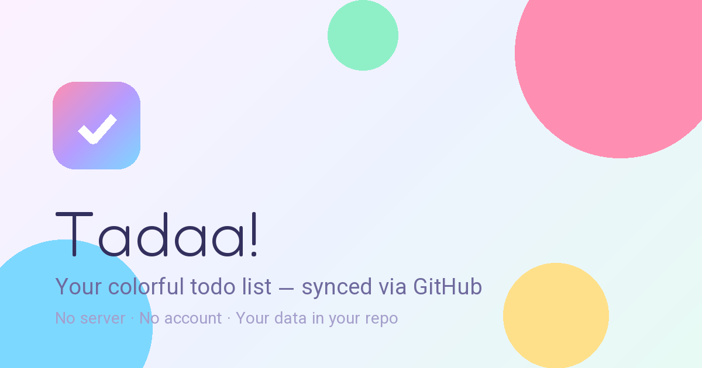

<div align="center">

# 🎉 Tadaa! — Online Todo List

**یه تودولیست پاستیلی، سه‌بعدی و پرانیمیشن که روی گیت‌هابِ خودت زندگی می‌کنه و بین همه دستگاه‌هات همگام می‌شه — بدون سرور، بدون حساب کاربری، بدون دیتابیس.**

[🚀 باز کردن اپ](https://pouriasafari117.github.io/Online_todolist/) · [📘 راهنمای راه‌اندازی](docs/SETUP.md) · [🏗 معماری](docs/ARCHITECTURE.md) · [🔐 امنیت](docs/SECURITY.md)



</div>

## ✨ چی داریم؟

- 🎨 **ظاهر پاستیلی و سه‌بعدی:** کارت‌های شیشه‌ای، مکعب لوگوی سه‌بعدی، حباب‌های رنگی شناور، گرین فیلم و سایه‌های نرم — با **تم روز/شب** (خودکار یا دستی) و رابط **فارسی/انگلیسی (RTL/LTR)**.
- 🖱️ **انیمیشن در هر حرکت:** کرسر سفارشی مغناطیسی، موج (Ripple) روی هر کلیک، پارالاکس پس‌زمینه با حرکت موس، ذره‌های رنگی (Sparkle)، ماسکات خمیری که چشمک می‌زنه و چشم‌هاش موس رو دنبال می‌کنن، کانفتی هنگام تیک‌زدن و جشن وقتی همه کارها تموم بشن.
- ✅ **تودولیست کامل:** اولویت (فوری/معمولی/آروم)، موعد با هشدار دیرکرد، برچسب، یادداشت، جستجو، فیلتر، مرتب‌سازی، **درگ‌اَند‌دراپ**، ویرایش در دیالوگ، حذف با Undo، پاک‌کردن گروهی انجام‌شده‌ها، خروجی/ورودی JSON.
- 📊 **داشبورد بامزه:** حلقه پیشرفت، آمار امروز و Streak، نمودار ۷ روز اخیر.
- 📱 **PWA:** قابل نصب روی موبایل/دسکتاپ، آفلاین هم کار می‌کند.
- ⌨️ **میان‌برها:** `N` کار جدید، `/` جستجو، `T` تم، `G` سینک، `?` راهنما.

## ☁️ همگام‌سازی بین دستگاه‌ها — بدون توکن برای هر دستگاه

مشکل کلاسیک: سینک‌کردن روی گیت‌هاب نیاز به **توکن** دارد و ساختن توکن برای هر دستگاه هم سخت است هم وقت‌گیر.

راه‌حل Tadaa! — **«قفل سینک» (Sync Vault):**

1. **یک بار** روی دستگاه اصلی یک توکن Fine-grained (فقط همین مخزن، فقط `Contents: Read/Write`) می‌سازی و یک **رمز سینک** انتخاب می‌کنی. دکمه‌ی «ساخت توکن در گیت‌هاب (پُرشده)» داخل اپ، نام/مالک/انقضا/دسترسی را از قبل پُر می‌کند و اپ موقع اتصال از خود گیت‌هاب می‌پرسد توکن دقیقاً به کدام مخزن‌ها می‌رسد: توکن کلاسیک (همه‌مخزنی) رد می‌شود و توکنی که به مخزن دیگری هم برسد مسدود می‌شود.
2. اپ، توکن را با رمز سینک و **AES-256-GCM** (کلید با PBKDF2، ۲۱۰هزار دور) رمزنگاری می‌کند و فایل قفل را روی سایت منتشر می‌کند (`todolist/vault.json`).
3. از آن به بعد، **هر دستگاه جدید فقط با همان رمز سینک** وارد می‌شود — نه توکنی، نه تنظیمی. رمز درست = قفل باز می‌شود و دستگاه مستقیم به مخزن وصل می‌شود.
4. خود داده‌های تسک هم (به‌صورت پیش‌فرض) رمزنگاری می‌شوند و روی شاخه جدا `todolist-data` در فایل `data/todos.json` ذخیره می‌شوند؛ پس سینک تسک‌ها هیچ‌وقت باعث بیلد دوباره سایت نمی‌شود.

تغییر رمز، اتصال دوباره، ابطال دسترسی و سناریوهای گم‌شدن دستگاه در [راهنما](docs/SETUP.md) قدم‌به‌قدم آمده. مدل تهدید را صادقانه در [SECURITY.md](docs/SECURITY.md) بخوانید: هرکس رمز سینک را دارد عملاً به لیست دسترسی دارد — پس مثل یک کلید از آن محافظت کنید.

## 🚀 شروع سریع

1. این مخزن را Fork/Clone کنید.
2. در **Settings → Pages**، Source را روی **GitHub Actions** بگذارید تا ورک‌فلو `.github/workflows/pages.yml` سایت را منتشر کند.
3. سایت را باز کنید → دکمه ابری → **«من صاحب لیستم»** → توکن + رمز سینک.
4. روی بقیه دستگاه‌ها فقط رمز سینک را بزنید. تمام!

جزئیات کامل: **[docs/SETUP.md](docs/SETUP.md)** (یا نسخه خوش‌ظاهرش: [docs/SETUP.html](docs/SETUP.html))

## 🧱 ساختار پروژه

```
index.html                  شل اپ + همه دیالوگ‌ها + آیکن‌های SVG
assets/
  css/  base · components · animations
  js/   theme-init · lib (کریپتو + GitHub API + i18n) · app (منطق UI و سینک)
  fonts/  وزیرمتن + Fredoka (خودمیزبان، بدون CDN)
  img/    آیکن‌ها و تصویر OG
todolist/vault.json         قفل رمزنگاری‌شده‌ی سینک (اپ خودش بازنویسی‌اش می‌کند)
manifest.webmanifest, sw.js PWA و آفلاین
.github/workflows/pages.yml انتشار خودکار روی GitHub Pages
docs/                       راهنما، معماری و امنیت
```

بدون هیچ وابستگی، بدون مرحله Build — فقط فایل استاتیک. داده‌ها در شاخه `todolist-data` ذخیره می‌شوند.

## 🧪 تست‌های کریپتو

با Node.js 20+ و بدون نصب وابستگی: `node --test tests/crypto.test.mjs`

## 📄 لایسنس

[MIT](LICENSE) — ساخته‌شده با ♥ و کلی انیمیشن.
